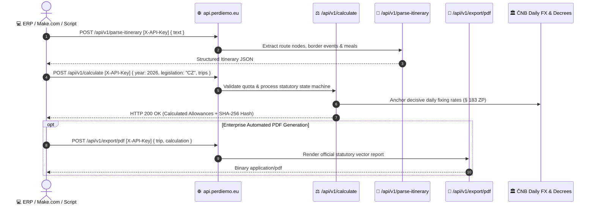

# PerDiemo REST API — Developer Documentation & Integration Guide

[](https://api.perdiemo.eu)
[](https://api.perdiemo.eu/docs)
[](https://api.perdiemo.eu/openapi.json)
[](https://www.perdiemo.eu/cz/legislativa)
[](https://www.perdiemo.eu)

Welcome to the official developer documentation for the **[PerDiemo](https://www.perdiemo.eu)** REST API. 

PerDiemo provides an automated calculation and parsing engine for statutory business travel allowances (*cestovní náhrady*), foreign per diems (*zahraniční stravné*), domestic meal brackets (*tuzemské stravné*), meal reduction rules (*krácení stravného*), daily ČNB exchange rate anchoring, and SHA-256 cryptographic audit trails under Czech and European labour law (**Act No. 262/2006 Coll., Labour Code, §§ 151–189**).

---

## 🌐 Base URLs & Environments

All API requests are routed through a high-performance Anycast edge reverse proxy with sub-15ms latency, automated SSL/TLS termination, and zero cold starts.

| Environment | Base URL | Canonical Endpoint Prefix | Status |
|---|---|---|---|
| **Production API Gateway** | `https://api.perdiemo.eu` | `/api/v1/*` | **Active / Production** |
| **Local Container (DEV)** | `http://localhost:8800` | `/api/v1/*` | Internal Docker |

Interactive OpenAPI documentation (Swagger UI) with live testing is available at:
* **Interactive Swagger UI**: [https://api.perdiemo.eu/docs](https://api.perdiemo.eu/docs)
* **OpenAPI 3.1 JSON Schema**: [https://api.perdiemo.eu/openapi.json](https://api.perdiemo.eu/openapi.json)
* **Health & Version Endpoint**: [https://api.perdiemo.eu/version](https://api.perdiemo.eu/version)

---

## 🔒 Authentication & Dual-Auth Architecture

The PerDiemo REST API uses a **Dual-Auth** security model supporting both cryptographic API keys for automated backend integrations and Bearer tokens for interactive web sessions:

1. **REST API Key (`X-API-Key`)** *(Recommended for B2B & Backend)*:
   * Pass your personal or corporate API key in the `X-API-Key` HTTP request header:
     ```http
     X-API-Key: pd_live_xxxxxxxxxxxxxxxxxxxxxxxxxxxxxxxxxxxxxxxxxxxxxxxx
     ```
   * Plaintext keys are revealed exactly once upon generation and hashed server-side using SHA-256.
   * Self-service key management is available directly inside the **PerDiemo User Settings** (`/cz/app/dashboard` ➔ Settings ➔ API Keys), where developers can issue custom-labeled keys and revoke compromised keys instantly.

2. **Supabase JWT (`Authorization: Bearer`)**:
   * For browser sessions and mobile applications:
     ```http
     Authorization: Bearer <jwt_access_token>
     ```
   * Authenticated using cryptographic HMAC-SHA256 signature verification.

3. **Quota Metering & Freemium Sandbox**:
   * Headless API calculations (`POST /api/v1/calculate`) and AI parsing operations are metered against your organization's active subscription tier:
     * **Free Tier Sandbox**: 10 calculations/year, 5 AI analyses/lifetime (€0).
     * **Solo / Starter**: 36 calculations/year, 40 AI analyses/year.
     * **Business**: 120 calculations/year, 120 AI analyses/year.
     * **Professional**: 600 calculations/year, 600 AI analyses/year.
     * **Enterprise**: Custom high-volume packages.
   * If your tier quota is exhausted, the API returns `HTTP 402 Payment Required` with upgrade links. Active quota consumption can be audited anytime via `GET /api/v1/user/usage`.

---

## 🏗️ Architecture & Interaction Flow



---

## 🚀 Core API Endpoints

### 1. Statutory Allowance Calculation (`POST /api/v1/calculate`)

Calculates statutory domestic and foreign per diems, meal reductions for employer-provided food, private vehicle wear-and-tear reimbursements, and decisive exchange rates. Generates a tamper-proof SHA-256 cryptographic verification signature for legal audit defense.

* **Method:** `POST`
* **Endpoint:** `/api/v1/calculate` (Dual trailing-slash `/api/v1/calculate/` also accepted)
* **Headers:** 
  * `Content-Type: application/json`
  * `X-API-Key: pd_live_...`

#### Request Payload Schema

```json
{
  "year": 2026,
  "legislation": "CZ",
  "include_routes": true,
  "trips": [
    {
      "id_cesty": "TRIP-2026-001",
      "ucel_cesty": "Client Negotiations & On-site Audit",
      "vlastnictvi_vozidla": "SLUZEBNI",
      "zamestnanec_jednatel": "Alex Miller",
      "spolecnost": "Acme Global Technologies Ltd.",
      "bezplatna_strava": {
        "2026-06-11": ["snidane"]
      },
      "itinerar": [
        {
          "typ": "ODJEZD",
          "datum": "2026-06-10T07:00",
          "misto": "Praha",
          "vzdalenost_km": 0.0,
          "country_code": "CZE",
          "transport_type": "company_car"
        },
        {
          "typ": "HRANICE_PRECHOD",
          "datum": "2026-06-10T09:30",
          "misto": "Mikulov",
          "vzdalenost_km": 200.0,
          "country_code": "CZE",
          "transport_type": "company_car"
        },
        {
          "typ": "PRIJEZD",
          "datum": "2026-06-10T11:00",
          "misto": "Wien",
          "vzdalenost_km": 90.0,
          "country_code": "AUT",
          "transport_type": "company_car",
          "layover_type": "meeting"
        },
        {
          "typ": "NÁVRAT_ODJEZD",
          "datum": "2026-06-11T16:00",
          "misto": "Wien",
          "vzdalenost_km": 0.0,
          "country_code": "AUT",
          "transport_type": "company_car"
        },
        {
          "typ": "HRANICE_NAVRAT",
          "datum": "2026-06-11T17:30",
          "misto": "Mikulov",
          "vzdalenost_km": 90.0,
          "country_code": "CZE",
          "transport_type": "company_car"
        },
        {
          "typ": "KREUZ_NAVRAT",
          "datum": "2026-06-11T20:00",
          "misto": "Praha",
          "vzdalenost_km": 200.0,
          "country_code": "CZE",
          "transport_type": "company_car"
        }
      ]
    }
  ]
}
```

#### Request Parameter Details:

| Parameter | Type | Required | Description |
|---|---|:---:|---|
| `year` | integer | Yes | Applicable statutory tax year (e.g. `2025`, `2026`). Governs statutory rates decreed by MPSV and MF ČR. |
| `legislation` | string | No | Legal jurisdiction: `"CZ"` (Czech Labour Code §§ 151–189, default), `"SK"`, or `"PL"`. |
| `include_routes` | boolean | No | When `true` (default), server computes daily consolidated route chains (`denni_prehled[].trasa`, e.g. `PRAHA, CZ ➔ WIEN, AT`). |
| `trips[].id_cesty` | string | Yes | Unique trip identifier generated by the client application. |
| `trips[].ucel_cesty` | string | No | Business purpose of the trip (e.g. `"Client Audit & Negotiation"`). |
| `trips[].vlastnictvi_vozidla` | string | Yes | Vehicle classification: `SLUZEBNI` (Company vehicle / air / train transit) or `OSOBNI` (Private employee vehicle eligible for mileage and fuel wear-and-tear reimbursement under § 157 ZP). |
| `trips[].zamestnanec_jednatel` | string | No | Employee or company officer name. |
| `trips[].spolecnost` | string | No | Employer company name. |
| `trips[].bezplatna_strava` | object | No | Map of ISO date strings (`YYYY-MM-DD`) to lists of employer-provided free meals (`"snidane"`: breakfast, `"obed"`: lunch, `"vecer"`: dinner). Triggers statutory reductions (*krácení*) under §§ 163 & 170 ZP. |
| `trips[].itinerar[].typ` | string | Yes | Leg event code: <br>• `ODJEZD` — Initial departure from origin / base.<br>• `PRIJEZD` — Arrival at destination / meeting point.<br>• `HRANICE_PRECHOD` — Outbound national border crossing.<br>• `NÁVRAT_ODJEZD` — Return leg departure.<br>• `HRANICE_NAVRAT` — Inbound national border crossing return.<br>• `KREUZ_NAVRAT` — Final return arrival at origin/home base. |
| `trips[].itinerar[].datum` | string | Yes | ISO 8601 timestamp string (`YYYY-MM-DDTHH:MM`). |
| `trips[].itinerar[].misto` | string | Yes | City or location name (e.g. `"Praha"`, `"Wien"`). |
| `trips[].itinerar[].vzdalenost_km` | number | No | Distance driven in kilometers for this segment (used for vehicle reimbursement calculations). |
| `trips[].itinerar[].country_code` | string | Yes | 3-letter ISO code (`CZE`, `AUT`, `DEU`, `SVK`, `POL`, `OZZ`). Primary statutory source of truth for rate jurisdiction. |
| `trips[].itinerar[].transport_type` | string | No | Transport mode: `company_car`, `private_vehicle`, `plane`, `train`, `bus`, `public_transit`, `walk`. |

#### Response Schema (HTTP 200 OK)

```json
{
  "metadata": {
    "year": 2026,
    "total_trips": 1,
    "total_stravne_czk": 1245.0,
    "total_kapesne_czk": 600.0,
    "total_kraceni_czk": 260.0,
    "total_vzdalenost_km": 580.0,
    "total_nahrada_vozidlo_czk": 0.0,
    "verification_signature": "1baebc05f2cab245d5901de7a1d8447d550d50d6d8ef9e940fa8007cddac219b"
  },
  "trip_reports": [
    {
      "souhrn_cesty": {
        "celkem_dnu": 2,
        "zahranicni_dny": 2,
        "tuzemske_dny": 0,
        "stravne_zahrani_czk": 1245.0,
        "stravne_zahrani_eur": 50.0,
        "kapesne_zahrani_czk": 600.0,
        "kraceni_zahrani_czk": 260.0,
        "stravne_po_kraceni_czk": 1245.0,
        "kapesne_czk": 600.0,
        "kraceni_czk": 260.0,
        "vzdalenost_km": 580.0,
        "nahrada_vozidlo_czk": 0.0,
        "verification_signature": "e5812..."
      },
      "denni_prehled": [
        {
          "datum": "2026-06-10",
          "trasa": "PRAHA, CZ ➔ MIKULOV, CZ ➔ WIEN, AT",
          "stravne_zahrani_czk": 750.0,
          "stravne_zahrani_eur": 30.0,
          "kapesne_zahrani_czk": 375.0,
          "kraceni_zahrani_czk": 0.0,
          "kurz_cnb": 25.00
        },
        {
          "datum": "2026-06-11",
          "trasa": "WIEN, AT ➔ MIKULOV, CZ ➔ PRAHA, CZ",
          "stravne_zahrani_czk": 495.0,
          "stravne_zahrani_eur": 20.0,
          "kapesne_zahrani_czk": 225.0,
          "kraceni_zahrani_czk": 260.0,
          "kurz_cnb": 25.00
        }
      ]
    }
  ]
}
```

---

### 2. Natural Language Itinerary Extraction (`POST /api/v1/parse-itinerary`)

Converts unstructured free-text trip notes, Slack logs, travel approval emails, or calendar exports into structured chronological itineraries with automatic transport mode detection, intermediate border-crossing nodes, and meal provisions. Supports both English and Czech prompts.

* **Method:** `POST`
* **Endpoint:** `/api/v1/parse-itinerary`
* **Headers:** 
  * `Content-Type: application/json`
  * `X-API-Key: pd_live_...`

#### Request Payload

```json
{
  "text": "Odjezd z Prahy v pondělí 10. června 2026 v 07:00 služebním vozem do Vídně na obchodní jednání. Přechod hranic Mikulov v 09:30, příjezd do Vídně v 11:00. Ubytování v hotelu se snídaní. V úterý 11. června odjezd z Vídně v 16:00, návrat přes hranice v 17:30, příjezd do Prahy ve 20:00."
}
```

---

### 3. Programmatic Statutory PDF Report Export (`POST /api/v1/export/pdf`)

Renders a complete, legally compliant statutory travel expense report (*Vyúčtování pracovní cesty*) in vector PDF format, stamped with the decisive ČNB exchange rate and SHA-256 cryptographic verification fingerprint.

> [!NOTE]
> **Enterprise Feature**: Automated programmatic PDF export via API is an **Enterprise tier** capability. Unlicensed API calls return `HTTP 403 Forbidden`. Interactive PDF downloads via the web application dashboard remain fully included for all registered user tiers.

* **Method:** `POST`
* **Endpoint:** `/api/v1/export/pdf`
* **Headers:**
  * `Content-Type: application/json`
  * `X-API-Key: pd_live_...`
* **Response:** Binary `application/pdf` stream.

---

### 4. Account Quota & Consumption Status (`GET /api/v1/user/usage`)

Inspects active calculation and AI extraction quota consumption for the authenticated user or corporate account. Enforces strict zero-trust identity isolation.

* **Method:** `GET`
* **Endpoint:** `/api/v1/user/usage`
* **Headers:** `X-API-Key: pd_live_...`

#### Response Schema (HTTP 200 OK)

```json
{
  "user_id": "00000000-0000-0000-0000-000000000001",
  "tier": "business",
  "billing_cycle": "annual",
  "trips_used_this_year": 14,
  "max_trips_per_year": 120,
  "ai_used_this_year": 18,
  "max_ai_per_year": 120
}
```

---

### 5. Statutory Country Mappings (`GET /api/v1/country-mappings`)

Returns official ISO 3166-1 alpha-3 / alpha-2 country codes, Czech and English geographic designations, and statutory per diem base currencies.

* **Method:** `GET`
* **Endpoint:** `/api/v1/country-mappings`

---

### 6. Health & Engine Version Check (`GET /version`)

Public endpoint returning active backend SemVer, API contract version, and runtime status.

* **Method:** `GET`
* **Endpoint:** `/version` (or `/api/v1/version`)

#### Response Schema (HTTP 200 OK)

```json
{
  "status": "online",
  "version": "1.0.14",
  "api_version": "v1",
  "service": "perdiemo-backend"
}
```

---

## 🐍 Drop-in Python SDK Client (`perdiemo_client.py`)

Here is a zero-dependency, lightweight Python client ready to drop directly into your automation pipelines:

```python
"""
perdiemo_client.py — Zero-dependency client for the PerDiemo REST API v1.
"""
import requests
from typing import Dict, Any, List, Optional

class PerDiemoClient:
    def __init__(self, api_key: str, base_url: str = "https://api.perdiemo.eu"):
        self.base_url = base_url.rstrip("/")
        self.session = requests.Session()
        self.session.headers.update({
            "Content-Type": "application/json",
            "X-API-Key": api_key
        })

    def version(self) -> Dict[str, Any]:
        """Check API status and engine SemVer."""
        r = self.session.get(f"{self.base_url}/version", timeout=10)
        r.raise_for_status()
        return r.json()

    def usage(self) -> Dict[str, Any]:
        """Inspect active subscription tier and quota consumption."""
        r = self.session.get(f"{self.base_url}/api/v1/user/usage", timeout=10)
        r.raise_for_status()
        return r.json()

    def parse_itinerary(self, text: str) -> Dict[str, Any]:
        """Parse natural language trip text into a structured statutory itinerary."""
        r = self.session.post(
            f"{self.base_url}/api/v1/parse-itinerary",
            json={"text": text},
            timeout=30
        )
        r.raise_for_status()
        return r.json()

    def calculate(
        self,
        trips: List[Dict[str, Any]],
        year: int = 2026,
        legislation: str = "CZ",
        include_routes: bool = True
    ) -> Dict[str, Any]:
        """Calculate statutory per diems, ČNB exchange fixings, and audit signatures."""
        payload = {
            "year": year,
            "legislation": legislation,
            "include_routes": include_routes,
            "trips": trips
        }
        r = self.session.post(
            f"{self.base_url}/api/v1/calculate",
            json=payload,
            timeout=30
        )
        r.raise_for_status()
        return r.json()


# Example Usage:
if __name__ == "__main__":
    API_KEY = "pd_live_your_api_key_here"
    client = PerDiemoClient(api_key=API_KEY)
    
    print("API Engine Status:", client.version())
    
    # 1. Parse natural language trip log (English or Czech supported)
    trip_text = (
        "Departed Prague on June 10, 2026 at 07:00 by company car to Vienna for client meetings. "
        "Crossed border at Mikulov at 09:30, arrived in Vienna at 11:00. Overnight at hotel with "
        "complimentary breakfast. On June 11 departed Vienna at 16:00, crossed border back into "
        "Czechia at 17:30, arrived in Prague at 20:00."
    )
    parsed = client.parse_itinerary(trip_text)
    print("Parsed Business Purpose:", parsed.get("ucel_cesty"))
    
    # 2. Calculate statutory allowances and audit signatures
    calculation = client.calculate(trips=[{
        "id_cesty": "TRIP-2026-001",
        "ucel_cesty": parsed.get("ucel_cesty", "Client Meeting"),
        "vlastnictvi_vozidla": parsed.get("typ_vozidla", "SLUZEBNI"),
        "bezplatna_strava": parsed.get("bezplatna_strava", {}),
        "itinerar": parsed.get("itinerary", [])
    }], year=2026, legislation="CZ")
    
    meta = calculation["metadata"]
    print("Net Statutory Per Diem (CZK):", meta["total_stravne_czk"])
    print("Tax-Shielded Pocket Money (CZK):", meta["total_kapesne_czk"])
    print("Meal Deductions (CZK):", meta["total_kraceni_czk"])
    print("Audit Verification Hash:", meta["verification_signature"])
```

---

## 💻 JavaScript / TypeScript (`fetch`) Example

```typescript
const BASE_URL = "https://api.perdiemo.eu/api/v1";
const API_KEY = "pd_live_your_api_key_here";

async function calculateTrip() {
  const response = await fetch(`${BASE_URL}/calculate`, {
    method: "POST",
    headers: {
      "Content-Type": "application/json",
      "X-API-Key": API_KEY
    },
    body: JSON.stringify({
      year: 2026,
      legislation: "CZ",
      include_routes: true,
      trips: [{
        id_cesty: "TRIP-2026-001",
        ucel_cesty: "Prague to Vienna Client Negotiations",
        vlastnictvi_vozidla: "SLUZEBNI",
        bezplatna_strava: { "2026-06-11": ["snidane"] },
        itinerar: [
          { typ: "ODJEZD", datum: "2026-06-10T07:00", misto: "Praha", vzdalenost_km: 0, country_code: "CZE" },
          { typ: "HRANICE_PRECHOD", datum: "2026-06-10T09:30", misto: "Mikulov", vzdalenost_km: 200, country_code: "CZE" },
          { typ: "PRIJEZD", datum: "2026-06-10T11:00", misto: "Wien", vzdalenost_km: 90, country_code: "AUT" },
          { typ: "NÁVRAT_ODJEZD", datum: "2026-06-11T16:00", misto: "Wien", vzdalenost_km: 0, country_code: "AUT" },
          { typ: "HRANICE_NAVRAT", datum: "2026-06-11T17:30", misto: "Mikulov", vzdalenost_km: 90, country_code: "CZE" },
          { typ: "KREUZ_NAVRAT", datum: "2026-06-11T20:00", misto: "Praha", vzdalenost_km: 200, country_code: "CZE" }
        ]
      }]
    })
  });

  const result = await response.json();
  console.log("Total Per Diem (CZK):", result.metadata.total_stravne_czk);
  console.log("Audit Signature:", result.metadata.verification_signature);
}

calculateTrip();
```

---

## 🔒 Statutory Integrity & Audit Guarantee

Every calculation generated by `POST /api/v1/calculate` produces two levels of SHA-256 cryptographic verification signatures:
1. `trip_reports[].souhrn_cesty.verification_signature`: SHA-256 hash sealing input legs, dates, vehicle type, and statutory outputs.
2. `metadata.verification_signature`: Master session hash sealing all trips within the submission, decisive ČNB fixing rates, and active engine SemVer.

This complies with the strict evidentiary burden requirements (*důkazní břemeno*) affirmed by the Czech **Supreme Administrative Court (NSS ruling 3 Afs 97/2025 - 71)** for tax deduction admissibility.

---

## 📄 License & Attribution

PerDiemo API and documentation are maintained by **DataQuo s.r.o.**  
For support or enterprise partnerships: `info@perdiemo.eu` • [https://www.perdiemo.eu](https://www.perdiemo.eu)
