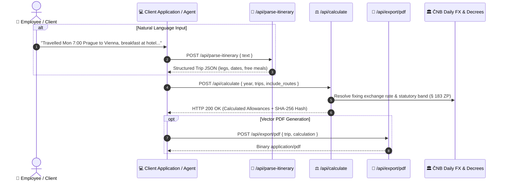

# PerDiemo REST API — Developer Documentation & Integration Guide

[](https://perdiemo-backend-production.onrender.com)
[](https://perdiemo-backend-production.onrender.com/openapi.json)
[](https://www.perdiemo.eu/cz/legislativa)
[](https://www.perdiemo.eu)

Welcome to the official developer documentation for the **[PerDiemo](https://www.perdiemo.eu)** REST API. 

PerDiemo provides an automated calculation and parsing engine for statutory business travel allowances (*cestovní náhrady*), foreign per diems (*zahraniční stravné*), domestic meal brackets (*tuzemské stravné*), meal reduction rules (*krácení stravného*), daily ČNB exchange rate anchoring, and SHA-256 cryptographic audit trails under Czech and European labour law (**Act No. 262/2006 Coll., Labour Code, §§ 151–189**).

---

## 🌐 Base URLs & Environments

| Environment | Base URL | Access & CORS | Status |
|---|---|---|---|
| **Production Cloud** | `https://perdiemo-backend-production.onrender.com` | Public REST (`Access-Control-Allow-Origin: *`) | **Active / Stable** |
| **Local Container (DEV)** | `http://localhost:8000` | Local Docker Compose network | Internal |

Interactive OpenAPI documentation (Swagger UI) is available at:
* **Interactive Docs**: `https://perdiemo-backend-production.onrender.com/docs`
* **OpenAPI JSON Schema**: `https://perdiemo-backend-production.onrender.com/openapi.json`

---

## 🏗️ Architecture & Interaction Flow



---

## 🚀 Core API Endpoints

### 1. Statutory Allowance Calculation (`POST /api/calculate`)

Calculates statutory domestic and foreign per diems, meal reductions for employer-provided food, private vehicle wear-and-tear reimbursements, and decisive exchange rates. Generates a tamper-proof SHA-256 cryptographic verification signature for legal audit defense.

* **Method:** `POST`
* **Endpoint:** `/api/calculate`
* **Headers:** `Content-Type: application/json`

#### Request Payload Schema

```json
{
  "year": 2025,
  "include_routes": true,
  "trips": [
    {
      "id_cesty": "TRIP-2025-001",
      "ucel_cesty": "Client Negotiations & On-site Audit",
      "vlastnictvi_vozidla": "SLUZEBNI",
      "zamestnanec_jednatel": "Alex Miller",
      "spolecnost": "Acme Global Technologies Ltd.",
      "bezplatna_strava": {
        "2025-06-11": ["snidane"]
      },
      "itinerar": [
        {
          "typ": "ODJEZD",
          "datum": "2025-06-10T07:00",
          "misto": "Praha",
          "vzdalenost_km": 0.0,
          "country_code": "CZE",
          "transport_type": "company_car"
        },
        {
          "typ": "HRANICE_PRECHOD",
          "datum": "2025-06-10T09:30",
          "misto": "Mikulov",
          "vzdalenost_km": 200.0,
          "country_code": "CZE",
          "transport_type": "company_car"
        },
        {
          "typ": "PRIJEZD",
          "datum": "2025-06-10T11:00",
          "misto": "Wien",
          "vzdalenost_km": 90.0,
          "country_code": "AUT",
          "transport_type": "company_car",
          "layover_type": "meeting"
        },
        {
          "typ": "NÁVRAT_ODJEZD",
          "datum": "2025-06-11T16:00",
          "misto": "Wien",
          "vzdalenost_km": 0.0,
          "country_code": "AUT",
          "transport_type": "company_car"
        },
        {
          "typ": "HRANICE_NAVRAT",
          "datum": "2025-06-11T17:30",
          "misto": "Mikulov",
          "vzdalenost_km": 90.0,
          "country_code": "CZE",
          "transport_type": "company_car"
        },
        {
          "typ": "KREUZ_NAVRAT",
          "datum": "2025-06-11T20:00",
          "misto": "Praha",
          "vzdalenost_km": 200.0,
          "country_code": "CZE",
          "transport_type": "company_car"
        }
      ]
    }
  ]
}
```

#### Request Parameter Details:

| Parameter | Type | Required | Description |
|---|---|:---:|---|
| `year` | integer | Yes | Applicable statutory tax year (e.g. `2024`, `2025`, `2026`). Governs statutory per diem rates decreed by the Ministry of Labour and Ministry of Finance. |
| `include_routes` | boolean | No | When `true` (default), server consolidates multi-leg segments into a continuous daily chain (`denni_prehled[].trasa`, e.g. `PRAHA, CZ ➔ WIEN, AT`). |
| `trips[].id_cesty` | string | Yes | Unique trip identifier generated by the client application. |
| `trips[].ucel_cesty` | string | No | Business purpose of the trip (e.g. `"Client Audit & Negotiation"`). |
| `trips[].vlastnictvi_vozidla` | string | Yes | Vehicle ownership classification: `SLUZEBNI` (Company vehicle / air / train transit) or `OSOBNI` (Private employee vehicle eligible for statutory mileage and fuel wear-and-tear reimbursement under § 157 ZP). |
| `trips[].zamestnanec_jednatel` | string | No | Employee or company officer name. |
| `trips[].spolecnost` | string | No | Employer company name. |
| `trips[].bezplatna_strava` | object | No | Map of ISO date strings (`YYYY-MM-DD`) to lists of employer-provided free meals (`"snidane"`: breakfast, `"obed"`: lunch, `"vecer"`: dinner). Triggers statutory deductions (*krácení*) under §§ 163 & 170 ZP. |
| `trips[].itinerar[].typ` | string | Yes | Leg event code: <br>• `ODJEZD` — Initial departure from origin / base.<br>• `PRIJEZD` — Arrival at destination / meeting point.<br>• `HRANICE_PRECHOD` — Outbound national border crossing.<br>• `NÁVRAT_ODJEZD` — Return leg departure.<br>• `HRANICE_NAVRAT` — Inbound national border crossing return.<br>• `KREUZ_NAVRAT` — Final return arrival at origin/home base. |
| `trips[].itinerar[].datum` | string | Yes | ISO 8601 timestamp string (`YYYY-MM-DDTHH:MM`). |
| `trips[].itinerar[].misto` | string | Yes | City or location name (e.g. `"Prague"`, `"Vienna"`). |
| `trips[].itinerar[].vzdalenost_km` | number | No | Distance driven in kilometers for this segment (used for vehicle reimbursement calculations). |
| `trips[].itinerar[].country_code` | string | Yes | 3-letter ISO code (`CZE`, `AUT`, `DEU`, `SVK`, `POL`, `OZZ`). Primary statutory source of truth for rate jurisdiction. |
| `trips[].itinerar[].transport_type` | string | No | Transport mode: `company_car`, `private_vehicle`, `plane`, `train`, `bus`, `public_transit`, `walk`. |

#### Response Schema (HTTP 200 OK)

```json
{
  "metadata": {
    "year": 2025,
    "total_trips": 1,
    "total_stravne_czk": 1226.61,
    "total_kapesne_czk": 594.72,
    "total_kraceni_czk": 260.19,
    "total_vzdalenost_km": 580.0,
    "total_nahrada_vozidlo_czk": 0.0,
    "verification_signature": "1baebc05f2cab245d5901de7a1d8447d550d50d6d8ef9e940fa8007cddac219b"
  },
  "trip_reports": [
    {
      "souhrn_cesty": {
        "celkem_dnu": 2,
        "zahranicni_dny": 2,
        "tuzemske_dny": 0,
        "stravne_zahrani_czk": 1226.61,
        "stravne_zahrani_eur": 49.0,
        "kapesne_zahrani_czk": 594.72,
        "kraceni_zahrani_czk": 260.19,
        "stravne_po_kraceni_czk": 1226.61,
        "kapesne_czk": 594.72,
        "kraceni_czk": 260.19,
        "vzdalenost_km": 580.0,
        "nahrada_vozidlo_czk": 0.0,
        "verification_signature": "e5812..."
      },
      "denni_prehled": [
        {
          "datum": "2025-06-10",
          "trasa": "PRAHA, CZ ➔ MIKULOV, CZ ➔ WIEN, AT",
          "stravne_zahrani_czk": 743.4,
          "stravne_zahrani_eur": 30.0,
          "kapesne_zahrani_czk": 371.7,
          "kraceni_zahrani_czk": 0.0,
          "kurz_cnb": 24.78
        },
        {
          "datum": "2025-06-11",
          "trasa": "WIEN, AT ➔ MIKULOV, CZ ➔ PRAHA, CZ",
          "stravne_zahrani_czk": 483.21,
          "stravne_zahrani_eur": 19.5,
          "kapesne_zahrani_czk": 223.02,
          "kraceni_zahrani_czk": 260.19,
          "kurz_cnb": 24.78
        }
      ]
    }
  ]
}
```

#### Response Field Reference:

| Field | Type / Unit | Description |
|---|:---:|---|
| `metadata.total_stravne_czk` | CZK | Net statutory per diem allowance across all computed trips. |
| `metadata.total_kapesne_czk` | CZK | Statutory non-taxable pocket money allowance (*kapesné*, up to 40% of foreign per diem under § 180 ZP). |
| `metadata.total_kraceni_czk` | CZK | Total reduction deducted for employer-provided meals (§ 163 & § 170 ZP). |
| `metadata.verification_signature` | SHA-256 Hex | Master session cryptographic fingerprint sealing all calculation inputs and statutory parameters for tax audit defense. |
| `trip_reports[].denni_prehled[].trasa` | string | Consolidated route chain for the calendar day (e.g. `PRAHA, CZ ➔ WIEN, AT`). |
| `trip_reports[].denni_prehled[].kurz_cnb` | CZK/FX | Official daily exchange rate fixing from the Czech National Bank on decisive day (§ 183 ZP). |

---

### 2. Natural Language Itinerary Extraction (`POST /api/parse-itinerary`)

Uses multimodal GenAI parsing to convert raw text logs, Slack messages, emails, or notes into structured chronological itineraries with automatic transport mode detection and breakfast identification. Works with both English and Czech input prompts.

* **Method:** `POST`
* **Endpoint:** `/api/parse-itinerary`
* **Headers:** `Content-Type: application/json`

#### Request Payload (English Prompt)

```json
{
  "text": "Departed Prague on Monday June 10, 2025 at 07:00 AM by company car to Vienna for client meetings. Crossed the border at Mikulov at 09:30 AM, arrived in Vienna at 11:00 AM. Hotel overnight with complimentary breakfast. On Tuesday June 11 departed Vienna at 16:00, crossed border back into Czechia at 17:30, arrived in Prague at 20:00."
}
```

#### Response Schema (HTTP 200 OK)

```json
{
  "ucel_cesty": "Client meetings in Vienna",
  "typ_vozidla": "SLUZEBNI",
  "itinerary": [
    {
      "typ": "ODJEZD",
      "datum": "2025-06-10T07:00",
      "misto": "Prague",
      "vzdalenost_km": 0.0,
      "transport_type": "company_car",
      "country_code": "CZE"
    },
    {
      "typ": "HRANICE_PRECHOD",
      "datum": "2025-06-10T09:30",
      "misto": "Mikulov",
      "vzdalenost_km": 200.0,
      "transport_type": "company_car",
      "country_code": "CZE"
    },
    {
      "typ": "PRIJEZD",
      "datum": "2025-06-10T11:00",
      "misto": "Vienna",
      "vzdalenost_km": 80.0,
      "transport_type": "company_car",
      "layover_type": "meeting",
      "country_code": "AUT"
    },
    {
      "typ": "NÁVRAT_ODJEZD",
      "datum": "2025-06-11T16:00",
      "misto": "Vienna",
      "vzdalenost_km": 0.0,
      "transport_type": "company_car",
      "country_code": "AUT"
    },
    {
      "typ": "HRANICE_NAVRAT",
      "datum": "2025-06-11T17:30",
      "misto": "Mikulov",
      "vzdalenost_km": 80.0,
      "transport_type": "company_car",
      "country_code": "CZE"
    },
    {
      "typ": "KREUZ_NAVRAT",
      "datum": "2025-06-11T20:00",
      "misto": "Prague",
      "vzdalenost_km": 200.0,
      "transport_type": "company_car",
      "country_code": "CZE"
    }
  ],
  "bezplatna_strava": {
    "2025-06-11": [
      "snidane"
    ]
  },
  "model_used": "gemini-2.5-flash"
}
```

---

## 🐍 Drop-in Python SDK Client (`perdiemo_client.py`)

Here is a zero-dependency, lightweight Python client you can copy directly into your project:

```python
"""
perdiemo_client.py — Zero-dependency client for the PerDiemo REST API.
"""
import requests
from typing import Dict, Any, List, Optional

class PerDiemoClient:
    def __init__(self, base_url: str = "https://perdiemo-backend-production.onrender.com"):
        self.base_url = base_url.rstrip("/")
        self.session = requests.Session()
        self.session.headers.update({"Content-Type": "application/json"})

    def health(self) -> Dict[str, Any]:
        """Check API status and supported countries."""
        r = self.session.get(f"{self.base_url}/", timeout=10)
        r.raise_for_status()
        return r.json()

    def parse_itinerary(self, text: str) -> Dict[str, Any]:
        """Parse natural language trip description into structured itinerary."""
        r = self.session.post(
            f"{self.base_url}/api/parse-itinerary",
            json={"text": text},
            timeout=30
        )
        r.raise_for_status()
        return r.json()

    def calculate(self, trips: List[Dict[str, Any]], year: int = 2025, include_routes: bool = True) -> Dict[str, Any]:
        """Calculate statutory per diems and cryptographic verification signatures."""
        payload = {
            "year": year,
            "trips": trips,
            "include_routes": include_routes
        }
        r = self.session.post(
            f"{self.base_url}/api/calculate",
            json=payload,
            timeout=30
        )
        r.raise_for_status()
        return r.json()

# Example Usage:
if __name__ == "__main__":
    client = PerDiemoClient()
    print("Health Status:", client.health().get("status", "OK"))
    
    # 1. Parse natural language trip log (English or Czech supported)
    trip_text = "Departed Prague on June 10, 2025 at 07:00 by company car to Vienna for client meetings. Crossed border at Mikulov at 09:30, arrived in Vienna at 11:00. Overnight at hotel with complimentary breakfast. On June 11 departed Vienna at 16:00, crossed border back into Czechia at 17:30, arrived in Prague at 20:00."
    parsed = client.parse_itinerary(trip_text)
    print("Parsed Purpose:", parsed.get("ucel_cesty"))
    
    # 2. Calculate statutory allowances and audit signatures
    calculation = client.calculate(trips=[{
        "id_cesty": "TRIP-001",
        "ucel_cesty": parsed.get("ucel_cesty", "Client Meeting"),
        "vlastnictvi_vozidla": parsed.get("typ_vozidla", "SLUZEBNI"),
        "bezplatna_strava": parsed.get("bezplatna_strava", {}),
        "itinerar": parsed.get("itinerary", [])
    }], year=2025)
    
    print("Total Per Diem (CZK):", calculation["metadata"]["total_stravne_czk"])
    print("Pocket Money Allowance (CZK):", calculation["metadata"]["total_kapesne_czk"])
    print("Meal Deductions (CZK):", calculation["metadata"]["total_kraceni_czk"])
    print("Audit Verification Hash:", calculation["metadata"]["verification_signature"])
```

---

## 💻 JavaScript / TypeScript (`fetch`) Example

```typescript
const BASE_URL = "https://perdiemo-backend-production.onrender.com";

// 1. Calculate Allowances
async function calculateTrip() {
  const response = await fetch(`${BASE_URL}/api/calculate`, {
    method: "POST",
    headers: { "Content-Type": "application/json" },
    body: JSON.stringify({
      year: 2025,
      include_routes: true,
      trips: [{
        id_cesty: "TRIP-001",
        ucel_cesty: "Prague to Vienna Client Negotiations",
        vlastnictvi_vozidla: "SLUZEBNI",
        bezplatna_strava: { "2025-06-11": ["snidane"] },
        itinerar: [
          { typ: "ODJEZD", datum: "2025-06-10T07:00", misto: "Prague", vzdalenost_km: 0, country_code: "CZE" },
          { typ: "HRANICE_PRECHOD", datum: "2025-06-10T09:30", misto: "Mikulov", vzdalenost_km: 200, country_code: "CZE" },
          { typ: "PRIJEZD", datum: "2025-06-10T11:00", misto: "Vienna", vzdalenost_km: 80, country_code: "AUT" },
          { typ: "NÁVRAT_ODJEZD", datum: "2025-06-11T16:00", misto: "Vienna", vzdalenost_km: 0, country_code: "AUT" },
          { typ: "HRANICE_NAVRAT", datum: "2025-06-11T17:30", misto: "Mikulov", vzdalenost_km: 80, country_code: "CZE" },
          { typ: "KREUZ_NAVRAT", datum: "2025-06-11T20:00", misto: "Prague", vzdalenost_km: 200, country_code: "CZE" }
        ]
      }]
    })
  });

  const result = await response.json();
  console.log("Total Per Diem (CZK):", result.metadata.total_stravne_czk);
  console.log("Audit Signature:", result.metadata.verification_signature);
}

calculateTrip();
```

---

## 🔒 Statutory Integrity & Audit Guarantee

Every calculation generated by `POST /api/calculate` produces two levels of SHA-256 cryptographic verification signatures:
1. `trip_reports[].souhrn_cesty.verification_signature`: SHA-256 hash sealing input legs, dates, vehicle type, and allowance outputs.
2. `metadata.verification_signature`: Master session hash sealing all trips within the submission and engine build version.

This complies with the evidentiary burden requirements (*důkazní břemeno*) affirmed by the Czech **Supreme Administrative Court (NSS 3 Afs 97/2025 - 71)** for tax deduction admissibility.

---

## 📄 License & Attribution

PerDiemo API and documentation are maintained by **DataQuo s.r.o.**  
For support or enterprise partnerships: `info@perdiemo.eu` • [https://www.perdiemo.eu](https://www.perdiemo.eu)
