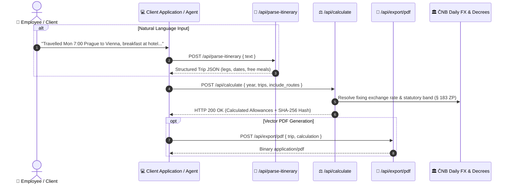

# PerDiemo REST API — Developer Documentation & Integration Guide

[](https://perdiemo-backend-production.onrender.com)
[](https://perdiemo-backend-production.onrender.com/openapi.json)
[](https://www.perdiemo.eu/cz/legislativa)
[](https://www.perdiemo.eu)

Welcome to the official developer documentation for the **[PerDiemo](https://www.perdiemo.eu)** REST API. 

PerDiemo provides an automated calculation and parsing engine for statutory business travel allowances (*cestovní náhrady*), foreign per diems (*zahraniční stravné*), domestic meal brackets (*tuzemské stravné*), meal reduction rules (*krácení stravného*), daily ČNB exchange rate anchoring, and SHA-256 cryptographic audit trails under Czech and European labour law (**Act No. 262/2006 Coll., Labour Code, §§ 151–189**).

---

## 🌐 Base URLs & Environments

| Environment | Base URL | Access & CORS | Status |
|---|---|---|---|
| **Production Cloud** | `https://perdiemo-backend-production.onrender.com` | Public REST (`Access-Control-Allow-Origin: *`) | **Active / Stable** |
| **Local Container (DEV)** | `http://localhost:8000` | Local Docker Compose network | Internal |

Interactive OpenAPI documentation (Swagger UI) is available at:
* **Interactive Docs**: `https://perdiemo-backend-production.onrender.com/docs`
* **OpenAPI JSON Schema**: `https://perdiemo-backend-production.onrender.com/openapi.json`

---

## 🏗️ Architecture & Interaction Flow



---

## 🚀 Core API Endpoints

### 1. Statutory Allowance Calculation (`POST /api/calculate`)

Calculates statutory domestic and foreign per diems, meal reductions for employer-provided food, private vehicle wear-and-tear reimbursements, and decisive exchange rates. Generates a tamper-proof SHA-256 cryptographic verification signature for legal audit defense.

* **Method:** `POST`
* **Endpoint:** `/api/calculate`
* **Headers:** `Content-Type: application/json`

#### Request Payload Schema

```json
{
  "year": 2025,
  "include_routes": true,
  "trips": [
    {
      "id_cesty": "TRIP-2025-001",
      "ucel_cesty": "Client Negotiations & On-site Audit",
      "vlastnictvi_vozidla": "SLUZEBNI",
      "zamestnanec_jednatel": "Jan Novák",
      "spolecnost": "Acme Corp s.r.o.",
      "bezplatna_strava": {
        "2025-06-11": ["snidane"]
      },
      "itinerar": [
        {
          "typ": "ODJEZD",
          "datum": "2025-06-10T07:00",
          "misto": "Praha",
          "vzdalenost_km": 0.0,
          "country_code": "CZE",
          "transport_type": "company_car"
        },
        {
          "typ": "HRANICE_PRECHOD",
          "datum": "2025-06-10T09:30",
          "misto": "Mikulov",
          "vzdalenost_km": 200.0,
          "country_code": "CZE",
          "transport_type": "company_car"
        },
        {
          "typ": "PRIJEZD",
          "datum": "2025-06-10T11:00",
          "misto": "Wien",
          "vzdalenost_km": 90.0,
          "country_code": "AUT",
          "transport_type": "company_car",
          "layover_type": "meeting"
        },
        {
          "typ": "NÁVRAT_ODJEZD",
          "datum": "2025-06-11T16:00",
          "misto": "Wien",
          "vzdalenost_km": 0.0,
          "country_code": "AUT",
          "transport_type": "company_car"
        },
        {
          "typ": "HRANICE_NAVRAT",
          "datum": "2025-06-11T17:30",
          "misto": "Mikulov",
          "vzdalenost_km": 90.0,
          "country_code": "CZE",
          "transport_type": "company_car"
        },
        {
          "typ": "KREUZ_NAVRAT",
          "datum": "2025-06-11T20:00",
          "misto": "Praha",
          "vzdalenost_km": 200.0,
          "country_code": "CZE",
          "transport_type": "company_car"
        }
      ]
    }
  ]
}
```

#### Request Parameter Details:
* `year` *(integer, required)*: Applicable tax year (e.g. `2024`, `2025`, `2026`). Governs statutory rates published by the Ministry of Labour and Ministry of Finance.
* `vlastnictvi_vozidla` *(string)*: `SLUZEBNI` (Company vehicle / transit) or `OSOBNI` (Private employee vehicle triggering statutory mileage and fuel compensation under § 157 ZP).
* `bezplatna_strava` *(object)*: Map of ISO date strings (`YYYY-MM-DD`) to lists of provided meals (`"snidane"`, `"obed"`, `"vecer"`). Triggers legal deduction (*krácení*) under § 163 and § 170 ZP.
* `itinerar[].typ` *(string)*:
  * `ODJEZD` — Origin departure.
  * `PRIJEZD` — Destination arrival / intermediate stop.
  * `HRANICE_PRECHOD` — Outbound national border crossing.
  * `NÁVRAT_ODJEZD` — Return leg departure.
  * `HRANICE_NAVRAT` — Inbound national border crossing return.
  * `KREUZ_NAVRAT` — Final return arrival at origin/home base.
* `itinerar[].country_code` *(string)*: 3-letter ISO code (e.g., `CZE`, `AUT`, `DEU`, `SVK`, `POL`, `OZZ`). Primary source of truth for rate jurisdiction.

#### Response Schema (HTTP 200 OK)

```json
{
  "metadata": {
    "year": 2025,
    "total_trips": 1,
    "total_stravne_czk": 1226.61,
    "total_kapesne_czk": 594.72,
    "total_kraceni_czk": 260.19,
    "total_vzdalenost_km": 580.0,
    "total_nahrada_vozidlo_czk": 0.0,
    "verification_signature": "1baebc05f2cab245d5901de7a1d8447d550d50d6d8ef9e940fa8007cddac219b"
  },
  "trip_reports": [
    {
      "souhrn_cesty": {
        "celkem_dnu": 2,
        "zahranicni_dny": 2,
        "tuzemske_dny": 0,
        "stravne_zahrani_czk": 1226.61,
        "stravne_zahrani_eur": 49.0,
        "kapesne_zahrani_czk": 594.72,
        "kraceni_zahrani_czk": 260.19,
        "stravne_po_kraceni_czk": 1226.61,
        "kapesne_czk": 594.72,
        "kraceni_czk": 260.19,
        "vzdalenost_km": 580.0,
        "nahrada_vozidlo_czk": 0.0,
        "verification_signature": "e5812..."
      },
      "denni_prehled": [
        {
          "datum": "2025-06-10",
          "trasa": "PRAHA, CZ ➔ MIKULOV, CZ ➔ WIEN, AT",
          "stravne_zahrani_czk": 743.4,
          "stravne_zahrani_eur": 30.0,
          "kapesne_zahrani_czk": 371.7,
          "kraceni_zahrani_czk": 0.0,
          "kurz_cnb": 24.78
        },
        {
          "datum": "2025-06-11",
          "trasa": "WIEN, AT ➔ MIKULOV, CZ ➔ PRAHA, CZ",
          "stravne_zahrani_czk": 483.21,
          "stravne_zahrani_eur": 19.5,
          "kapesne_zahrani_czk": 223.02,
          "kraceni_zahrani_czk": 260.19,
          "kurz_cnb": 24.78
        }
      ]
    }
  ]
}
```

---

### 2. Natural Language Itinerary Extraction (`POST /api/parse-itinerary`)

Uses multimodal GenAI parsing to convert raw text logs, Slack messages, emails, or notes into structured chronological itineraries with automatic transport mode detection and breakfast identification.

* **Method:** `POST`
* **Endpoint:** `/api/parse-itinerary`
* **Headers:** `Content-Type: application/json`

#### Request Payload

```json
{
  "text": "Odjel jsem v pondělí 10.6.2025 v 7:00 z Prahy autem do Vídně. Přechod hranic v Mikulově v 9:30. Ve Vídni jsem měl jednání, přespání v hotelu se snídaní. V úterý 11.6.2025 v 16:00 odjezd zpět do Prahy, hranice v Mikulově v 17:30, příjezd do Prahy ve 20:00."
}
```

#### Response Schema (HTTP 200 OK)

```json
{
  "ucel_cesty": "Jednání se klienty ve Vídni",
  "typ_vozidla": "OSOBNI",
  "itinerary": [
    {
      "typ": "ODJEZD",
      "datum": "2025-06-10T07:00",
      "misto": "Praha",
      "vzdalenost_km": 0.0,
      "transport_type": "private_vehicle",
      "country_code": "CZE"
    },
    {
      "typ": "HRANICE_PRECHOD",
      "datum": "2025-06-10T09:30",
      "misto": "Mikulov",
      "vzdalenost_km": 200.0,
      "transport_type": "private_vehicle",
      "country_code": "CZE"
    },
    {
      "typ": "PRIJEZD",
      "datum": "2025-06-10T10:45",
      "misto": "Vídeň",
      "vzdalenost_km": 90.0,
      "transport_type": "private_vehicle",
      "layover_type": "meeting",
      "country_code": "AUT"
    },
    {
      "typ": "NÁVRAT_ODJEZD",
      "datum": "2025-06-11T16:00",
      "misto": "Vídeň",
      "vzdalenost_km": 0.0,
      "country_code": "AUT"
    },
    {
      "typ": "HRANICE_NAVRAT",
      "datum": "2025-06-11T17:30",
      "misto": "Mikulov",
      "vzdalenost_km": 90.0,
      "country_code": "CZE"
    },
    {
      "typ": "KREUZ_NAVRAT",
      "datum": "2025-06-11T20:00",
      "misto": "Praha",
      "vzdalenost_km": 200.0,
      "country_code": "CZE"
    }
  ],
  "bezplatna_strava": {
    "2025-06-11": ["snidane"]
  }
}
```

---

## 🐍 Drop-in Python SDK Client (`perdiemo_client.py`)

Here is a zero-dependency, lightweight Python client you can copy directly into your project:

```python
"""
perdiemo_client.py — Zero-dependency client for the PerDiemo REST API.
"""
import requests
from typing import Dict, Any, List, Optional

class PerDiemoClient:
    def __init__(self, base_url: str = "https://perdiemo-backend-production.onrender.com"):
        self.base_url = base_url.rstrip("/")
        self.session = requests.Session()
        self.session.headers.update({"Content-Type": "application/json"})

    def health(self) -> Dict[str, Any]:
        """Check API status and supported countries."""
        r = self.session.get(f"{self.base_url}/", timeout=10)
        r.raise_for_status()
        return r.json()

    def parse_itinerary(self, text: str) -> Dict[str, Any]:
        """Parse natural language trip description into structured itinerary."""
        r = self.session.post(
            f"{self.base_url}/api/parse-itinerary",
            json={"text": text},
            timeout=30
        )
        r.raise_for_status()
        return r.json()

    def calculate(self, trips: List[Dict[str, Any]], year: int = 2025, include_routes: bool = True) -> Dict[str, Any]:
        """Calculate statutory per diems and cryptographic verification signatures."""
        payload = {
            "year": year,
            "trips": trips,
            "include_routes": include_routes
        }
        r = self.session.post(
            f"{self.base_url}/api/calculate",
            json=payload,
            timeout=30
        )
        r.raise_for_status()
        return r.json()

# Example Usage:
if __name__ == "__main__":
    client = PerDiemoClient()
    print("Health:", client.health()["status"])
    
    # 1. Parse natural language
    trip_text = "10.6.2025 8:00 Praha -> Brno 18:00, meeting with client, company car"
    parsed = client.parse_itinerary(trip_text)
    
    # 2. Calculate statutory allowances
    calculation = client.calculate(trips=[{
        "id_cesty": "TRIP-001",
        "ucel_cesty": parsed.get("ucel_cesty", "Business"),
        "vlastnictvi_vozidla": parsed.get("typ_vozidla", "SLUZEBNI"),
        "bezplatna_strava": parsed.get("bezplatna_strava", {}),
        "itinerar": parsed.get("itinerary", [])
    }], year=2025)
    
    print("Stravné CZK:", calculation["metadata"]["total_stravne_czk"])
    print("Audit Hash:", calculation["metadata"]["verification_signature"])
```

---

## 💻 JavaScript / TypeScript (`fetch`) Example

```typescript
const BASE_URL = "https://perdiemo-backend-production.onrender.com";

// 1. Calculate Allowances
async function calculateTrip() {
  const response = await fetch(`${BASE_URL}/api/calculate`, {
    method: "POST",
    headers: { "Content-Type": "application/json" },
    body: JSON.stringify({
      year: 2025,
      include_routes: true,
      trips: [{
        id_cesty: "TRIP-001",
        ucel_cesty: "Prague to Brno",
        vlastnictvi_vozidla: "SLUZEBNI",
        bezplatna_strava: {},
        itinerar: [
          { typ: "ODJEZD", datum: "2025-06-10T08:00", misto: "Praha", vzdalenost_km: 0 },
          { typ: "PRIJEZD", datum: "2025-06-10T18:00", misto: "Brno", vzdalenost_km: 210 }
        ]
      }]
    })
  });

  const result = await response.json();
  console.log("Total Stravné CZK:", result.metadata.total_stravne_czk);
  console.log("Audit Signature:", result.metadata.verification_signature);
}

calculateTrip();
```

---

## 🔒 Statutory Integrity & Audit Guarantee

Every calculation generated by `POST /api/calculate` produces two levels of SHA-256 cryptographic verification signatures:
1. `trip_reports[].souhrn_cesty.verification_signature`: SHA-256 hash sealing input legs, dates, vehicle type, and allowance outputs.
2. `metadata.verification_signature`: Master session hash sealing all trips within the submission and engine build version.

This complies with the evidentiary burden requirements (*důkazní břemeno*) affirmed by the Czech **Supreme Administrative Court (NSS 3 Afs 97/2025 - 71)** for tax deduction admissibility.

---

## 📄 License & Attribution

PerDiemo API and documentation are maintained by **DataQuo s.r.o.**  
For support or enterprise partnerships: `info@perdiemo.eu` • [https://www.perdiemo.eu](https://www.perdiemo.eu)
